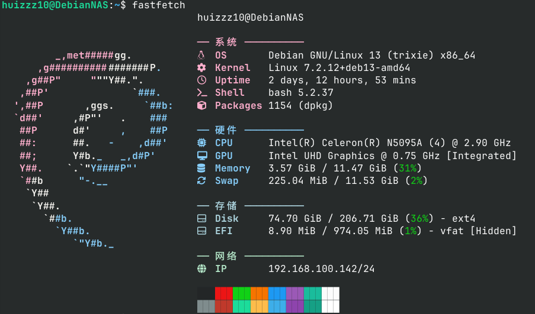
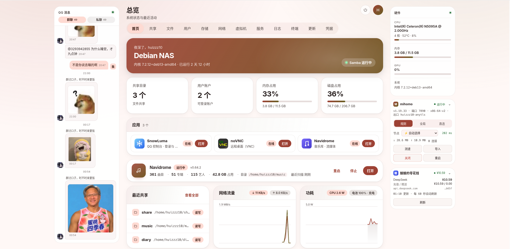

# 为什么养鱼

单纯觉得这种自己培养出一个AI**很有趣**  
同时很多人也在养，我也就想试试了  
还有就是要感谢梁圣，DeepSeek的API价格很便宜  

# 开始搭建

## 搭建平台选择

搭建平台无非三种：
- 云服务器
- 本地主机
- 安卓手机

刚刚好，我朋友把他的山寨笔记本送给了我，我就用这个笔记本来搭建**DebNAS**  

DebNAS项目地址：https://github.com/kekylin/debnas.git  

平台展示，**Debian**真的太好用了，我基于DebNAS做了**鱼缸**

## 架构选择

架构上就两条路：
- SnowLuma+qq-bridge
- AstrBot+NapCat

我最终选择了**SnowLuma+qq-bridge**，因为朋友部署了一个AstrBot+NapCat，感觉傻乎乎的  
同时，感觉SnowLuma的使用体感更适合我

## 搭建过程

> ***AI太好用了***

其实全程都是DSH在干活，我只是在许愿  
不过作为一个无图形界面的Debian系统，还是有点难度的  
所以我推荐使用dsh-tui这个插件，相当好用啊  
当然，你要在环境变量（~/.bashrc）中设置你DeepSeek的API Key，才能使用dsh-tui  

```bash
export DEEPSEEK_API_KEY="你的API Key"
```
ssh连接后，命令行输入`dsh-tui`，经过向导就可以，就可以开始许愿了

## 养鱼诀窍

首先是人设词，这个可以让AI给你个模板，然后进行精修  

然后是插件  
没什么特别的插件，我就装了几个插件
- dsh-balance-view（余额查询）
- dsh-bili-humanism（B站视频内容学习）
- dsh-bili-scroll（B站收藏点赞）
- dsh-mood（心情插件，让肥鱼更像人）
这些插件还需要qq-bridge的MCP进行搭配，这个可以vibe出来  
同时为了实现一些功能，如让她帮你管理文件，动态评论，记日记，这个也可以通过MCP来实现  

>***顺便受说一下，记得设置好她日记的各种规则，这可以让她更像人***

## 鱼缸管理

这台机器性能不止于此，毕竟它是一台NAS，不止于此，所以我vibe了一个**鱼缸**   
展示一下

如果也想像我一样使用DebNAS的话，可以到我的部署脚本仓库看看

# 结语

现在SnowLuma已经转为private了，我只能说f**k，Tencent！